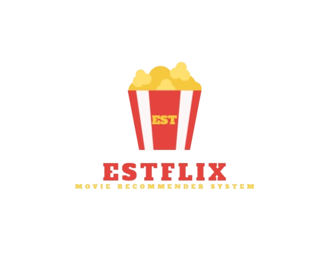

<p align="center">
  
</p>

<h1 align="center">🎬 ESTFLIX — Movie Recommender System</h1>

<p align="center">
  A Netflix-style web app that lets you browse, search and filter movies, and recommends similar ones.
</p>

<p align="center">
  
  
  
  
</p>

🇫🇷 Version française : [`README_fr.md`](README_fr.md)

---

## 📑 Table of Contents

- [Demo](#-demo)
- [Features](#-features)
- [How it works](#-how-it-works)
- [Tech stack](#-tech-stack)
- [Project structure](#-project-structure)
- [Installation](#-installation)
- [Generate the similarity matrix](#-generate-the-similarity-matrix)
- [TMDB API key](#-tmdb-api-key)
- [Usage](#-usage)
- [Limitations and future work](#-limitations-and-future-work)
- [Author](#-author)
- [Acknowledgements](#-acknowledgements)

---

## 🎥 Demo

▶️ **Demo video**: [watch / download on Google Drive](https://drive.google.com/file/d/1HGaehPgetpjYSsrHod8xmgquDl7SiBQz/view?usp=sharing)

<!-- Add screenshots to docs/images/ then uncomment:


-->

## ✨ Features

- **Home page** with the 10 most popular and the 10 most recent movies
- **Search by title** with **spelling-tolerant suggestions** ("Did you mean…")
- **Sidebar filters**: genres, actors, directors, and a release-year range, with pagination (10 movies per page)
- **Movie page**: poster, original title, release date, genres, original language, TMDB rating, director(s), cast, synopsis and a link to the **YouTube trailer**
- **10 similar movies** recommended for any selected movie
- **Poster cards** with a hover tooltip showing the key information, and a click to open the movie page
- **Cached TMDB calls** (24 h) so posters and ratings load quickly

## 🧠 How it works

1. The movie metadata and a **pre-computed movie-to-movie similarity matrix** are loaded from the `movie_informations/` folder (`.pkl` files) and cached by Streamlit.
2. When a movie is selected, the app finds its row in the similarity matrix, sorts the other movies by decreasing similarity, removes the movie itself and duplicates, and keeps the **top 10**.
3. Posters, ratings and trailers are fetched from the **TMDB API** (one call per movie, cached).
4. Search suggestions combine substring matching and `difflib` fuzzy matching, so typos still lead to the right title.

### Building the similarity matrix

The matrix is generated by [`build_similarity.py`](build_similarity.py):

1. For each movie, a **"tags" text** is built by concatenating its **overview, genres, cast and crew** (names are merged into single tokens, e.g. `Tom Hanks` → `TomHanks`, so each person stays one token).
2. The tags are vectorized with scikit-learn's **`CountVectorizer`** (bag of words, 5,000 most frequent terms, English stop words removed).
3. The **cosine similarity** between all movie vectors gives an N × N matrix, stored as `float32` to halve the file size, in `movie_informations/similarity.pkl`.

This is a **content-based filtering** approach: two movies are similar if they share vocabulary, genres, actors and directors.

## 🛠️ Tech stack

| Component | Tool |
|---|---|
| Interface | [Streamlit](https://streamlit.io/) (custom CSS for the poster cards) |
| Data handling | pandas, NumPy |
| Similarity computation | scikit-learn (`CountVectorizer`, cosine similarity) |
| Movie posters, ratings and trailers | [TMDB API](https://www.themoviedb.org/documentation/api) via `requests` |
| Fuzzy search | Python `difflib` |
| Storage | Pickled files (`.pkl`) |

## 📁 Project structure

```
<project-root>/
├── app.py                          # Streamlit application
├── build_similarity.py             # Builds similarity.pkl from the movies data
├── requirements.txt
├── LICENSE
├── README.md
├── README_fr.md
└── movie_informations/
    ├── ESTFLIX.png                 # Logo
    ├── movie_information.pkl       # Movies data (search, similarity, home page)
    ├── movie_information (1).pkl   # Movies data (sidebar filters)
    ├── movie_list.pkl              # Not used by app.py
    └── similarity.pkl              # Generated by build_similarity.py (not in the repo)
```

> `similarity.pkl` must have exactly one row per movie in `movie_information.pkl`; otherwise the app stops with an error message. If you change the movies data, re-run `build_similarity.py`.

## ⚙️ Installation

```bash
# 1. Clone the repository
git clone https://github.com/IliasKh/Movie_Recommendation.git
cd Movie_Recommendation

# 2. Create and activate a virtual environment
python -m venv .venv
.venv\Scripts\activate           # Windows
source .venv/bin/activate        # Linux / macOS

# 3. Install the dependencies
pip install -r requirements.txt
```

## 🧮 Generate the similarity matrix

`similarity.pkl` is a large file, so it is **not stored in the repository**. Generate it once after installing the dependencies, from the project root:

```bash
python build_similarity.py
```

It reads `movie_informations/movie_information.pkl` and writes `movie_informations/similarity.pkl`. On success it prints `OK : (N, N)`.

> ℹ️ The script also re-saves `movie_information.pkl` with a clean `0..n-1` index, because `app.py` uses the movie position to look up the similarity matrix.

Without `similarity.pkl`, the app stops and asks you to run this script.

## 🔑 TMDB API key

The app needs a free TMDB API key to display posters, ratings and trailers.

1. Create an account on [themoviedb.org](https://www.themoviedb.org/) and request an API key (Settings → API).
2. Provide it through the `TMDB_API_KEY` environment variable:

**Windows (PowerShell)**

```powershell
$env:TMDB_API_KEY = "your_api_key"
```

**Windows (cmd)**

```
set TMDB_API_KEY=your_api_key
```

**Linux / macOS**

```bash
export TMDB_API_KEY=your_api_key
```

> ⚠️ Never commit your API key to the repository.

## 🚀 Usage

```bash
streamlit run app.py
```

The app opens at <http://localhost:8501>.

- **Browse**: the home page shows the popular and recent movies. Click a poster to open the movie page and see 10 similar movies.
- **Search**: type a title and click **Search**. If the title does not exist exactly, click one of the suggestions.
- **Filter**: use the sidebar to select genres, actors or directors, then narrow down by release years and change pages.
- **Back**: click **← Accueil** to return to the home page.

If a file is missing from `movie_informations/`, the app displays an explicit error message.

## 🔭 Limitations and future work

- The interface mixes French and English labels (unified language option to add)
- Recommendations rely on a static similarity matrix: adding movies requires re-running `build_similarity.py`
- Posters, ratings and trailers depend on the TMDB API and an internet connection
- Possible improvements: user profiles and ratings, hybrid recommendation (content + collaborative filtering), deployment on Streamlit Community Cloud

## 👤 Author

**Ilias Khalifi**
<!-- Add your teammates or supervisor here if relevant. -->

## 🙏 Acknowledgements

This product uses the TMDB API but is not endorsed or certified by TMDB.


