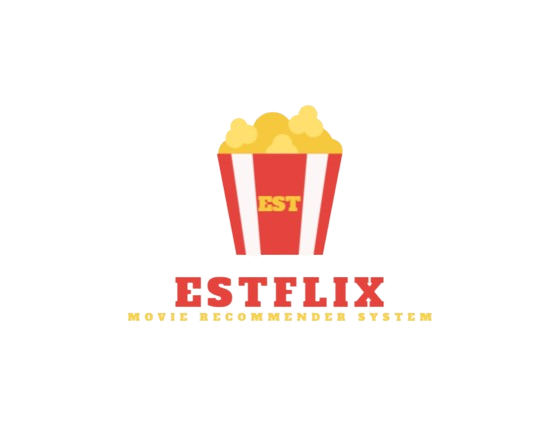

<p align="center">
  
</p>

<h1 align="center">🎬 ESTFLIX — Système de recommandation de films</h1>

<p align="center">
  Une application web façon Netflix pour parcourir, rechercher et filtrer des films, et obtenir des recommandations de films similaires.
</p>

<p align="center">
  
  
  
  
</p>

🇬🇧 English version: [`README.md`](README.md)

---

## 📑 Sommaire

- [Démo](#-démo)
- [Fonctionnalités](#-fonctionnalités)
- [Fonctionnement](#-fonctionnement)
- [Technologies](#-technologies)
- [Structure du projet](#-structure-du-projet)
- [Installation](#-installation)
- [Générer la matrice de similarité](#-générer-la-matrice-de-similarité)
- [Clé API TMDB](#-clé-api-tmdb)
- [Utilisation](#-utilisation)
- [Limites et évolutions](#-limites-et-évolutions)
- [Auteur](#-auteur)
- [Remerciements](#-remerciements)

---

## 🎥 Démo

▶️ **Vidéo de démonstration** : [regarder / télécharger sur Google Drive](https://drive.google.com/file/d/1HGaehPgetpjYSsrHod8xmgquDl7SiBQz/view?usp=sharing)

<!-- Ajoutez des captures dans docs/images/ puis décommentez :


-->

## ✨ Fonctionnalités

- **Page d'accueil** avec les 10 films les plus populaires et les 10 plus récents
- **Recherche par titre** avec **suggestions tolérantes aux fautes d'orthographe** (« Vouliez-vous dire… »)
- **Filtres latéraux** : genres, acteurs, réalisateurs et plage d'années de sortie, avec pagination (10 films par page)
- **Page d'un film** : affiche, titre original, date de sortie, genres, langue originale, note TMDB, réalisateur(s), acteurs, synopsis et lien vers la **bande-annonce YouTube**
- **10 films similaires** recommandés pour n'importe quel film sélectionné
- **Cartes d'affiches** avec une infobulle au survol qui affiche les informations clés, et un clic pour ouvrir la page du film
- **Appels TMDB mis en cache** (24 h) pour charger rapidement affiches et notes

## 🧠 Fonctionnement

1. Les données des films et une **matrice de similarité film-à-film précalculée** sont chargées depuis le dossier `movie_informations/` (fichiers `.pkl`) et mises en cache par Streamlit.
2. Quand un film est sélectionné, l'application retrouve sa ligne dans la matrice de similarité, trie les autres films par similarité décroissante, retire le film lui-même et les doublons, puis garde les **10 premiers**.
3. Les affiches, notes et bandes-annonces viennent de l'**API TMDB** (un appel par film, mis en cache).
4. Les suggestions de recherche combinent la recherche de sous-chaîne et la correspondance approchée de `difflib`, ce qui permet de retrouver le bon titre malgré une faute de frappe.

### Construction de la matrice de similarité

La matrice est générée par [`build_similarity.py`](build_similarity.py) :

1. Pour chaque film, un **texte « tags »** est construit en concaténant son **synopsis, ses genres, ses acteurs et son équipe** (les noms sont fusionnés en un seul mot, par exemple `Tom Hanks` → `TomHanks`, pour que chaque personne reste un seul token).
2. Les tags sont vectorisés avec le **`CountVectorizer`** de scikit-learn (sac de mots, 5 000 termes les plus fréquents, mots vides anglais retirés).
3. La **similarité cosinus** entre tous les vecteurs de films donne une matrice N × N, enregistrée en `float32` pour diviser la taille du fichier par deux, dans `movie_informations/similarity.pkl`.

C'est une approche de **filtrage basé sur le contenu** : deux films sont proches s'ils partagent du vocabulaire, des genres, des acteurs et des réalisateurs.

## 🛠️ Technologies

| Composant | Outil |
|---|---|
| Interface | [Streamlit](https://streamlit.io/) (CSS personnalisé pour les cartes d'affiches) |
| Manipulation des données | pandas, NumPy |
| Calcul de similarité | scikit-learn (`CountVectorizer`, similarité cosinus) |
| Affiches, notes et bandes-annonces | [API TMDB](https://www.themoviedb.org/documentation/api) via `requests` |
| Recherche approchée | `difflib` (Python) |
| Stockage | Fichiers sérialisés (`.pkl`) |

## 📁 Structure du projet

```
<racine-du-projet>/
├── app.py                          # Application Streamlit
├── build_similarity.py             # Construit similarity.pkl à partir des données des films
├── requirements.txt
├── LICENSE
├── README.md
├── README_fr.md
└── movie_informations/
    ├── ESTFLIX.png                 # Logo
    ├── movie_information.pkl       # Données des films (recherche, similarité, accueil)
    ├── movie_information (1).pkl   # Données des films (filtres latéraux)
    ├── movie_list.pkl              # Non utilisé par app.py
    └── similarity.pkl              # Généré par build_similarity.py (absent du dépôt)
```

> `similarity.pkl` doit avoir exactement une ligne par film de `movie_information.pkl` ; sinon l'application s'arrête avec un message d'erreur. Si vous modifiez les données des films, relancez `build_similarity.py`.

## ⚙️ Installation

```bash
# 1. Cloner le dépôt
git clone https://github.com/IliasKh/Movie_Recommendation.git
cd Movie_Recommendation

# 2. Créer et activer un environnement virtuel
python -m venv .venv
.venv\Scripts\activate           # Windows
source .venv/bin/activate        # Linux / macOS

# 3. Installer les dépendances
pip install -r requirements.txt
```

## 🧮 Générer la matrice de similarité

`similarity.pkl` est un fichier volumineux, il n'est donc **pas stocké dans le dépôt**. Générez-le une fois après l'installation des dépendances, depuis la racine du projet :

```bash
python build_similarity.py
```

Le script lit `movie_informations/movie_information.pkl` et écrit `movie_informations/similarity.pkl`. En cas de succès, il affiche `OK : (N, N)`.

> ℹ️ Le script réenregistre aussi `movie_information.pkl` avec un index propre `0..n-1`, car `app.py` utilise la position du film pour lire la matrice de similarité.

Sans `similarity.pkl`, l'application s'arrête et vous demande de lancer ce script.

## 🔑 Clé API TMDB

L'application a besoin d'une clé API TMDB gratuite pour afficher les affiches, les notes et les bandes-annonces.

1. Créez un compte sur [themoviedb.org](https://www.themoviedb.org/) et demandez une clé API (Paramètres → API).
2. Fournissez-la via la variable d'environnement `TMDB_API_KEY` :

**Windows (PowerShell)**

```powershell
$env:TMDB_API_KEY = "votre_cle_api"
```

**Windows (cmd)**

```
set TMDB_API_KEY=votre_cle_api
```

**Linux / macOS**

```bash
export TMDB_API_KEY=votre_cle_api
```

> ⚠️ Ne publiez jamais votre clé API dans le dépôt.

## 🚀 Utilisation

```bash
streamlit run app.py
```

L'application s'ouvre sur <http://localhost:8501>.

- **Parcourir** : la page d'accueil affiche les films populaires et récents. Cliquez sur une affiche pour ouvrir la page du film et voir 10 films similaires.
- **Rechercher** : saisissez un titre et cliquez sur **Search**. Si le titre n'existe pas exactement, cliquez sur l'une des suggestions.
- **Filtrer** : utilisez le panneau latéral pour choisir des genres, acteurs ou réalisateurs, puis affinez par années de sortie et changez de page.
- **Retour** : cliquez sur **← Accueil** pour revenir à la page d'accueil.

Si un fichier manque dans `movie_informations/`, l'application affiche un message d'erreur explicite.

## 🔭 Limites et évolutions

- L'interface mélange des libellés français et anglais (option de langue unifiée à ajouter)
- Les recommandations reposent sur une matrice de similarité statique : l'ajout de films demande de relancer `build_similarity.py`
- Affiches, notes et bandes-annonces dépendent de l'API TMDB et d'une connexion internet
- Pistes d'amélioration : profils utilisateurs et notes, recommandation hybride (contenu + filtrage collaboratif), déploiement sur Streamlit Community Cloud

## 👤 Auteur

**Ilias Khalifi**

<!-- Ajoutez ici vos coéquipiers ou votre encadrant si besoin. -->

## 🙏 Remerciements

Ce produit utilise l'API TMDB mais n'est ni approuvé ni certifié par TMDB.


